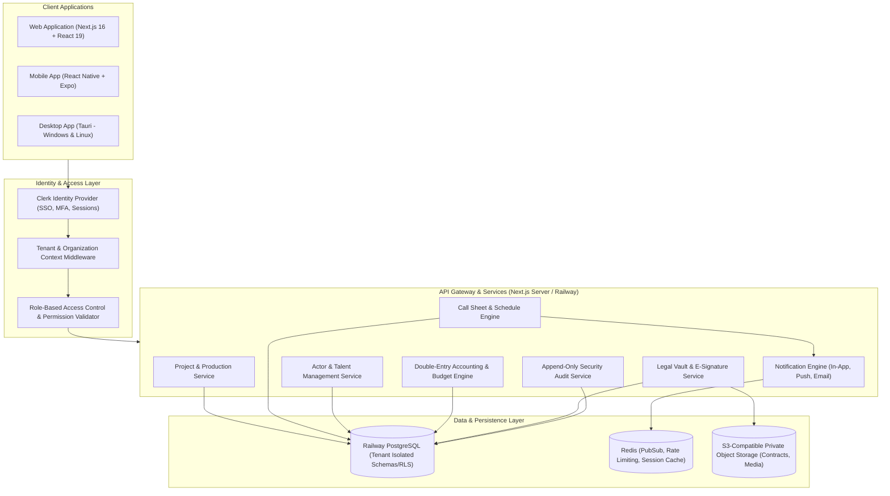

# System Architecture Document
## CINEMA OS — Monorepo & Platform Architecture

### 1. Monorepo Organization
The platform is organized as a clean, modular monorepo structured for high code reuse across Web, Mobile, and Desktop clients:

```
FILM-MANAGEMENT OS/
├── apps/
│   ├── web/                     # Next.js 16 (App Router), React 19, Tailwind CSS v4, DropX foundational UI
│   │   ├── app/
│   │   │   ├── (admin)/         # Film Studio, Production House, Manager, & Actor portals
│   │   │   │   ├── super-admin/ # Platform-wide tenant & plan administration
│   │   │   │   ├── production/  # Production House workspace & studio operations
│   │   │   │   ├── projects/    # Movies, series, short films, ad campaigns
│   │   │   │   ├── actors/      # Actor profiles, portfolio, schedules, remuneration
│   │   │   │   ├── manager/     # Manager multi-actor console & switchboard
│   │   │   │   ├── casting/     # Casting calls, auditions, shortlists, role offers
│   │   │   │   ├── call-sheets/ # Heart of CINEMA OS: call sheets, revisions, signatures
│   │   │   │   ├── calendar/    # Master production & shooting calendar
│   │   │   │   ├── crew/        # 16 Film departments, crew rosters, daily attendance
│   │   │   │   ├── finance/     # Budgets, expenses, payables, receivables, P&L
│   │   │   │   ├── documents/   # Secure legal contracts, NDAs, releases, e-signatures
│   │   │   │   ├── locations/   # Shooting locations, permits, tech recce, maps
│   │   │   │   ├── travel/      # Flights, hotel blocks, vehicle fleets, itineraries
│   │   │   │   ├── communications/ # Production chat, department feeds, meetings
│   │   │   │   └── reports/     # Operational & financial executive reporting
│   │   │   ├── (auth)/          # Authentication (Clerk-powered & enterprise SSO)
│   │   │   └── api/             # RESTful API routes & webhook receivers
│   │   ├── components/
│   │   │   ├── layout/          # Sidebar, header, user menu, footer (with DataDropX credit)
│   │   │   ├── ui/              # Reusable design primitives (Buttons, Cards, Modals, Inputs)
│   │   │   ├── modules/         # Specialized domain components (CallSheetBuilder, BudgetGrid, etc.)
│   │   │   └── providers/       # Redux, NextThemes, Clerk, Toast, Modal providers
│   │   ├── lib/                 # Utilities, decimal math, PDF generator, date helpers
│   │   ├── store/               # Redux Toolkit state slices
│   │   ├── types/               # TypeScript domain contracts
│   │   └── config/              # Navigation, permissions, site configuration
│   ├── mobile/                  # React Native + Expo mobile application (Actors, Managers, Crew)
│   └── desktop/                 # Tauri desktop configuration (Windows & Linux native wrappers)
├── packages/
│   ├── database/                # Drizzle ORM schema, PostgreSQL migrations, seed data, client
│   ├── shared/                  # Common domain logic, decimal calculation, date validation
│   └── config/                  # Shared brand tokens, constants, role definitions
├── docs/                        # Complete technical and product blueprints
├── IMPLEMENTATION_STATUS.md     # Granular phase-by-phase feature and testing tracker
└── package.json                 # Monorepo root configuration
```

---

### 2. High-Level Architecture Diagram



---

### 3. Core Architectural Principles
1. **Tenant Isolation First:** Every query filtering tenant-scoped resources (`projects`, `call_sheets`, `actors`, `finance`) must include the verified `organization_id` derived from the cryptographically verified session token, never trusting client-supplied organization IDs.
2. **Actor Multi-Affiliation:** Actors have a global identity profile that can be authorized across multiple distinct production houses and talent agencies without data leakage. An actor explicitly grants permissions to organizations to access their schedule and portfolio.
3. **Decimal-Safe Financial Arithmetic:** All financial transactions (budgets, expenses, disbursements) operate on exact fixed-point or integer micro-currency values. Rounding logic adheres to GAAP/IFRS standards.
4. **Call Sheet Versioning & Conflict Shield:** When an assistant director modifies a call sheet or shooting schedule, the system performs pre-flight conflict detection (double-booked actors, crew rest period violations, location overlaps) before publishing and archiving the previous version.
5. **Offline Resiliency:** Actors and crew in remote film locations (deserts, forests, sound stages with RF shielding) can review their call sheets and daily shooting requirements offline using local caching.

