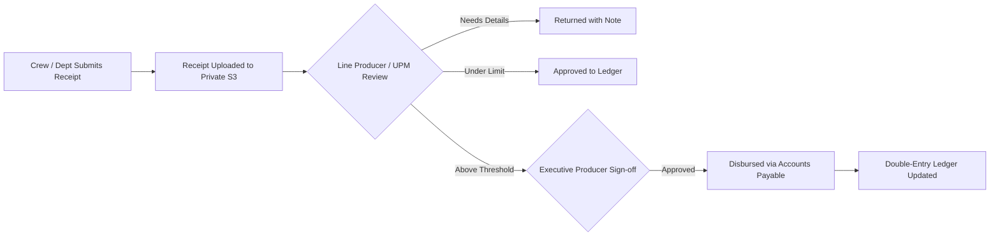

# Production Financial Engine & Double-Entry Accounting
## CINEMA OS — Film Production Budgeting & Ledger Architecture

### 1. Architectural Philosophy
Film productions operate with high-stakes budgets with strict auditability. Standard floating-point arithmetic introduces rounding drift (e.g. `0.1 + 0.2 = 0.30000000000000004`), which is unacceptable for multi-million dollar film financing.
CINEMA OS enforces:
1. **Integer Minor-Unit Storage:** All financial records are stored as 64-bit BigInt cents/paise (e.g., $150,000.00 is stored as `15000000`).
2. **Double-Entry General Ledger:** Every expense, invoice payment, or budget reallocation creates matched debit and credit journal lines ensuring the fundamental equation:
   $$\text{Assets} = \text{Liabilities} + \text{Equity}$$
3. **Multi-Currency Support:** Strict ISO-4217 currency tracking with recorded exchange rates per transaction date.

---

### 2. Film Industry Chart of Accounts

```
1000 - Production Operating Accounts (Bank / Escrow)
2000 - Accounts Payable & Actor Remuneration Payable
3000 - Equity / Production Investor Capital
4000 - Production Income & Pre-Sales / OTT Minimum Guarantees
5000 - Above-The-Line Costs (Story, Writer, Director, Producers, Cast)
6000 - Production Period (Crew, Camera, Sound, Art, Locations, Wardrobe)
7000 - Post-Production Period (Editing, Color Grading, VFX, Sound Mix)
8000 - General Logistics & Legal / Insurance Contingency
```

---

### 3. Expense Approval Workflow



---

### 4. Variance & Burn Rate Analytics
- **Estimated vs Approved vs Actual:**
  $$\text{Budget Variance} = \text{Approved Budget} - \text{Actual Expended}$$
- **Daily Shoot Burn Rate:** Total actual daily costs divided by shooting days completed.
- **Estimated Cost to Complete (EAC):**
  $$\text{EAC} = \text{Actuals To Date} + \frac{\text{Remaining Shooting Days} \times \text{Average Daily Burn Rate}}{\text{Overtime Factor}}$$

