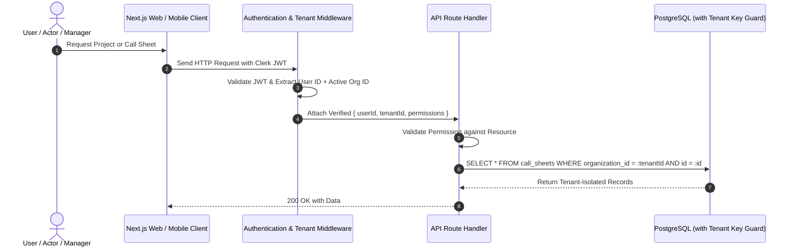

# Multi-Tenant Isolation & Data Boundaries
## CINEMA OS — Secure Multi-Tenant Architecture

### 1. Tenancy Model Overview
CINEMA OS serves three distinct multi-tenant organizational categories with strict isolation:
1. **Production Houses / Film Studios:** Completely private projects, scripts, call sheets, internal budgets, vendor deals, and crew rosters.
2. **Talent Management Agencies:** Private client rosters, commission structures, audition logs, and negotiation history.
3. **Independent Actors & Managers:** Dual-scoped profiles where public portfolio data is discoverable, but sensitive contracts, daily call times, and financial statements are strictly access-controlled.

---

### 2. Multi-Tenant Request Lifecycle

---

### 3. Cross-Tenant Collaboration Boundaries
An actor may be managed by Agency X while performing in Movie Y produced by Studio Z.
- **Rules of Cross-Tenant Access:**
  - Studio Z can view Actor's character call time, on-set attendance, and costume measurements for Movie Y only.
  - Studio Z cannot view Actor's contracts or payments from Studio W.
  - Agency X can view Actor's schedule across Movie Y and Audition Q to prevent scheduling conflicts.
  - Agency X cannot view confidential scripts or budget lines of Movie Y unless expressly shared.

